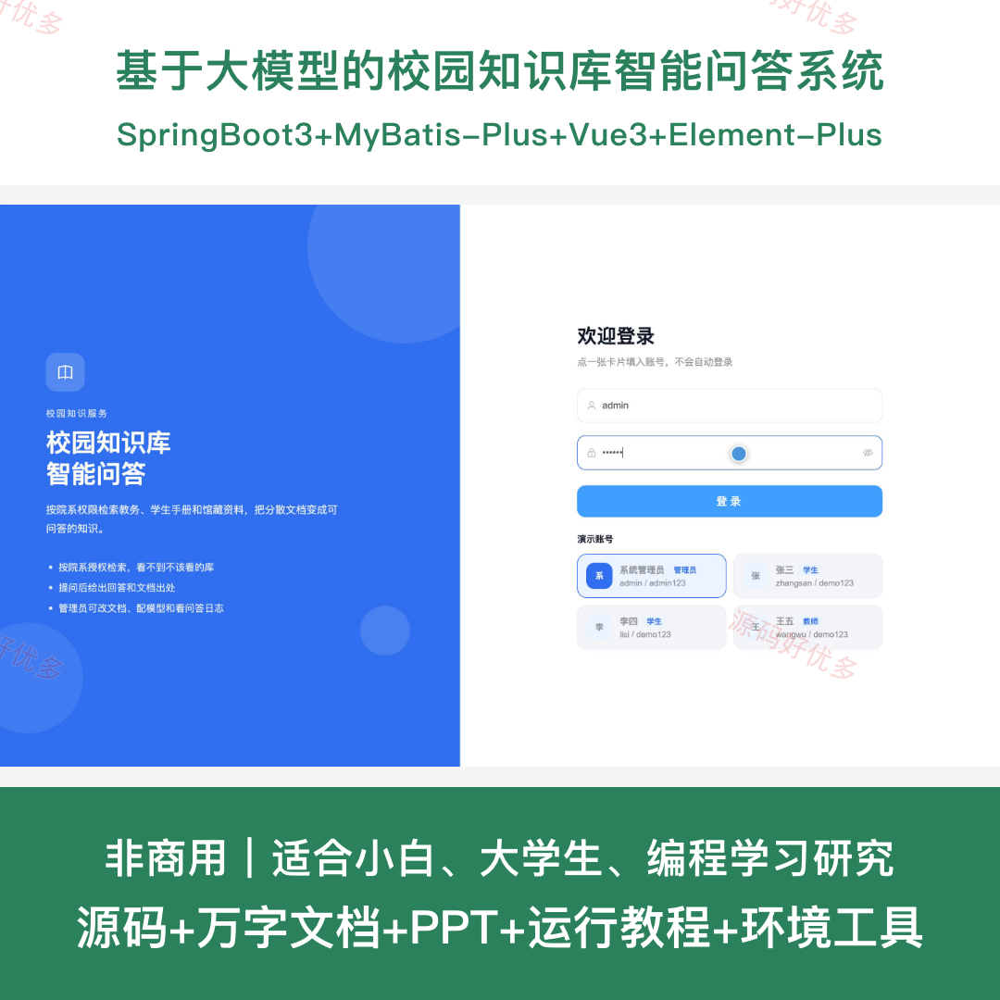
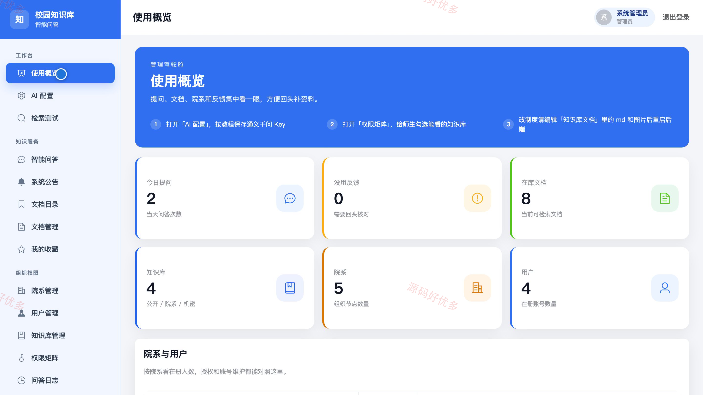
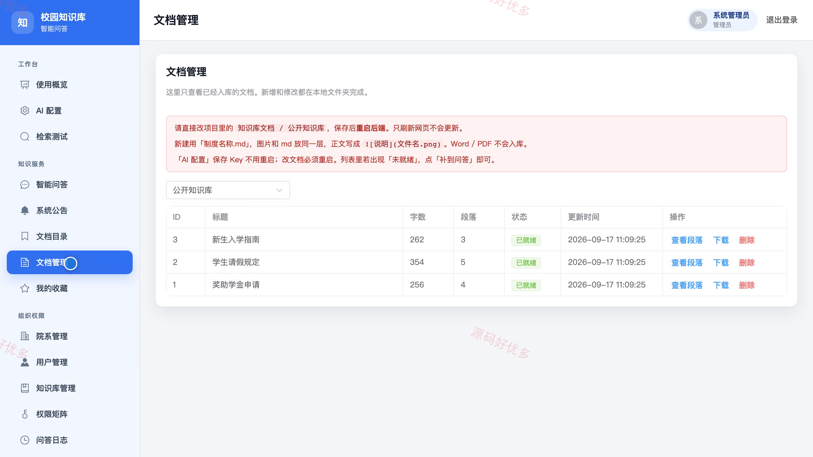
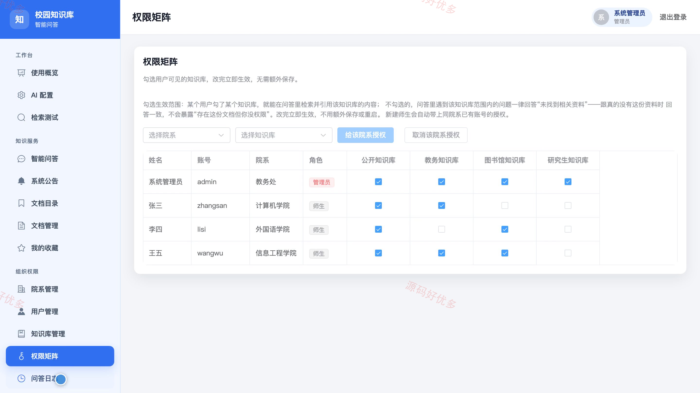
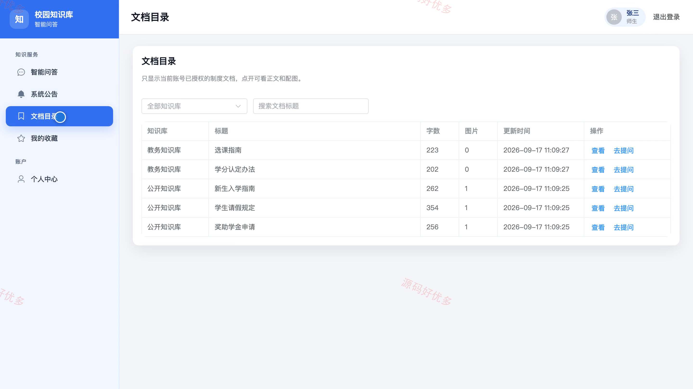
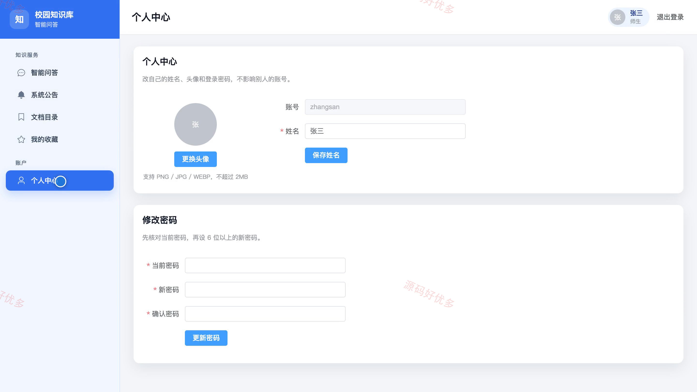

# bs162B
bs162B大模型校园知识库智能问答系统源码JavaSpringBoot3Vue3文档PPT
## 源码问题查看主页咨询

### 一、关键词
校园知识库、智能问答、检索增强生成、院系知识服务、知识权限管理

### 二、作品包含
源码+数据库+万字设计文档+PPT+全套环境和工具资源+本地部署教程

### 三、项目技术
前端技术： Html、Css、Js、Vue3.4、Element-Plus
后端技术：Java、SpringBoot3.2.5、MyBatis-Plus

### 四、运行环境要求
开发工具：IDEA/eclipse + VSCODE

数据库：MySQL5.7+（共12张表）

数据库管理工具：Navicat10以上版本

环境配置软件： JDK17 + Maven3.6

前端Nodejs：16+

浏览器：谷歌浏览器

### 五、项目介绍
项目编号：bs162B

本系统面向校园管理员和师生，按用户授权范围检索校园文档，支持智能问答、引用溯源、问答收藏、知识库与权限维护，并通过问答日志辅助内容完善。

角色：管理员、师生

管理员功能：使用概览、AI配置、检索测试、智能问答与收藏、公告发布与管理、用户与院系管理、知识库文档与权限管理、问答日志审计。

师生功能：智能问答、会话记录管理、授权文档目录查看、系统公告查看、问答收藏管理、个人资料维护。

### 六、运行截图

